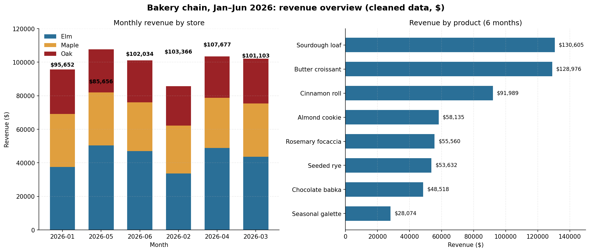

# Bakery Chain Sales Review — January to June 2026

Prepared for the owner. Source: `sales.csv` (4,368 raw rows, 181 days × 3 stores × 8 products). All figures below are **revenue** (`qty × unit_price`), not profit; costs are not in the data.

## 1. Headline numbers

- **Total revenue (cleaned data, net of returns): $595,488.50**
- **Total units sold (net): 118,937** (gross positive sales 119,009 units; 72 units recorded as negative/returns)
- **Average daily revenue: $3,289.99** across 181 days.
- **Highest month: May 2026 ($107,677.00)**; **lowest: February ($85,656.50)**.
- Revenue from January to June grew **+5.7%** ($95,652.00 → $101,103.00), but the path is not smooth: February fell about **10.4%** from January, then March–May rose, and June softened about **6.1%** from May.

### Monthly revenue

| Month | Units | Revenue | Days | Avg revenue/day |
|---|---:|---:|---:|---:|
| Jan 2026 | 19,059 | $95,652.00 | 31 | $3,085.55 |
| Feb 2026 | 17,142 | $85,656.50 | 28 | $3,059.16 |
| Mar 2026 | 20,333 | $102,034.50 | 31 | $3,291.44 |
| Apr 2026 | 20,607 | $103,365.50 | 30 | $3,445.52 |
| May 2026 | 21,554 | $107,677.00 | 31 | $3,473.45 |
| Jun 2026 | 20,242 | $101,103.00 | 30 | $3,370.10 |

### Store performance

| Store | Revenue | Share | Units | Avg revenue/day |
|---|---:|---:|---:|---:|
| Elm | $261,043.00 | 43.8% | 52,202 | $1,442.23 |
| Maple | $182,650.50 | 30.7% | 36,420 | $1,009.17 |
| Oak | $151,795.00 | 25.5% | 30,315 | $838.65 |

Elm is the clear leader: about **43.8% of revenue** and roughly **72% more revenue than Oak**. January-to-June store trends differ sharply:

- **Elm: +25.7%** ($37,459.50 → $47,072.00)
- **Maple: −8.3%** ($31,665.00 → $29,048.00)
- **Oak: −5.8%** ($26,527.50 → $24,983.00)

So the overall growth is driven by Elm; Maple and Oak are declining.

### Product performance

| Product | Revenue | Share | Units | Revenue/unit |
|---|---:|---:|---:|---:|
| Sourdough loaf | $130,605.00 | 21.9% | 17,414 | $7.50 |
| Butter croissant | $128,976.00 | 21.7% | 32,244 | $4.00 |
| Cinnamon roll | $91,989.00 | 15.5% | 20,442 | $4.50 |
| Almond cookie | $58,135.00 | 9.8% | 23,254 | $2.50 |
| Rosemary focaccia | $55,560.00 | 9.3% | 6,945 | $8.00 |
| Seeded rye | $53,631.50 | 9.0% | 8,251 | $6.50 |
| Chocolate babka | $48,518.00 | 8.2% | 5,708 | $8.50 |
| Seasonal galette | $28,074.00 | 4.7% | 4,679 | $6.00 |

Two important mix points:

1. **Butter croissant is the unit-volume leader (32,244 units, 27.1% of units)** but only second in revenue because it sells at $4.00.
2. **Sourdough loaf is the revenue leader** despite far lower volume (17,414 units) because of its $7.50 price. Cinnamon roll and sourdough together account for **37.4% of revenue**.
3. The bottom two products — chocolate babka ($48,518, 8.2%) and seasonal galette ($28,074, 4.7%) — contribute little. Seasonal galette is the lowest-revenue item and may be a candidate for range rationalization or a targeted promotion.

### Weekend effect

| Day type | Revenue | Days | Avg revenue/day |
|---|---:|---:|---:|
| Weekdays (Mon–Fri) | $362,669.50 | 129 | $2,811.39 |
| Weekends (Sat–Sun) | $232,819.00 | 52 | $4,477.29 |

Weekends generate **39.1% of revenue on 28.7% of days**, and average **59.3% more per day** than weekdays. Saturday and Sunday averages are nearly identical ($4,490 and $4,465), while Friday–Thursday weekdays cluster around $2,780–$2,836.

### Best and worst days

- Best: **2026-04-12, $5,015.50**; then 2026-06-14 ($5,014.50), 2026-05-23 ($5,007.50).
- Worst: **2026-02-04, $2,331.00**; then 2026-01-16 ($2,400.00) and 2026-02-24 ($2,406.50).

## 2. Data-quality problems found and how they were handled

The raw file has 4,368 rows, but **only 4,344 unique combinations** exist. The cleaned dataset is exactly **181 days × 3 stores × 8 products = 4,344 rows**, with every store-product-day combination present.

| Issue | Count | Handling |
|---|---:|---|
| Exact duplicate rows (same date, store, product, qty, price) | **24** | Removed with `drop_duplicates()`, keeping one copy. The duplicates would have added **628 units and $3,417.50** (about 0.57% of revenue), so they materially distort totals. |
| Missing `unit_price` | **3** | Imputed using the product's fixed price: Oak Seasonal galette 2026-02-26 (qty 7, $6.00); Elm Seasonal galette 2026-03-17 (qty 11, $6.00); Elm Butter croissant 2026-05-28 (qty 81, $4.00). Added revenue: **$432.00**. |
| Negative `qty` | **6** | Treated as returns/corrections and kept in net revenue (they reduce revenue by **$543.50**, or 72 units). Gross sales excluding negatives are **$596,032.00**. |
| Zero `qty` | **1** | Oak Seasonal galette, 2026-06-08; retained as a zero-sale record, no revenue effect. |

The imputation is safe because **every product has exactly one unit price across all rows** — min = max for each product, so there were no price changes or promotions recorded. No malformed dates, no missing dates, and no missing store/product/date combinations were found after deduplication.

Caveats: returns are inferred from negative quantities; the data does not label them. Duplicates are assumed to be accidental repeated entries, not legitimate separate transactions. Revenue excludes costs and waste, so product recommendations based on revenue alone should be checked against margins.

## 3. Recommendations

1. **Fix the data pipeline before management reporting.** Enforce the key `(date, store, product)`, reject exact duplicates, require a positive quantity for sales, log returns/refunds separately with a reason, and require `unit_price`. Validate that each day has 3 stores × 8 products; the current grid is complete only after cleaning.

2. **Prioritize Elm and investigate Maple/Oak decline.** Elm grew 25.7% and holds 43.8% of revenue; Maple (−8.3%) and Oak (−5.8%) are slipping. Check local foot traffic, staffing, opening hours, stock-outs, and competitor activity at Maple and Oak. Reallocation of staff, baking capacity, and inventory toward Elm is likely justified, but confirm store size and catchment first.

3. **Staff and bake for weekends.** Weekend daily revenue is about 59% above weekdays. Increase weekend production and staffing — especially for croissants, sourdough, and cinnamon rolls — and avoid stock-outs on Saturday/Sunday. Conversely, use weekday capacity for prep and slower-moving items.

4. **Protect the sourdough/cinnamon revenue core.** Sourdough and cinnamon rolls are 37.4% of revenue despite lower unit volume than croissants. Keep them consistently available; their higher price makes them the revenue anchors. Consider bundling croissants (volume leader) with higher-priced items to lift basket value.

5. **Review the low-revenue tail.** Chocolate babka (8.2%) and seasonal galette (4.7%) are the weakest products. Test whether the galette is seasonal/promotional; if it is genuinely low-demand, reduce SKU count or run a targeted promotion rather than carrying it across all stores.

6. **Address the February dip and June softening.** February fell about 10.4% from January and June fell about 6.1% from May. Check weather, holidays, and post-holiday demand; plan promotions or production adjustments for those periods.

7. **Track revenue per unit and margin, not just units.** Croissants lead units but not revenue; almond cookies are high-volume but low-price. Before delisting or promoting items, add cost/margin data — the current file supports revenue analysis only.
