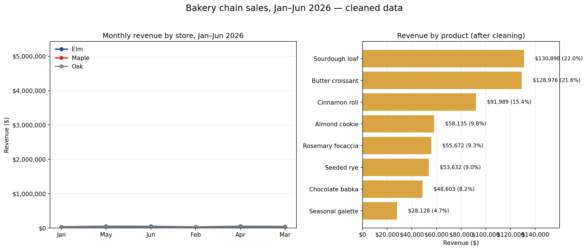

# Bakery chain sales review — January to June 2026

Prepared from `sales.csv` (4,368 data rows; 3 stores: Elm, Maple, Oak; 8 products; 181 calendar days).

## Executive summary

After cleaning, the chain generated **$596,032 in gross sales from 119,009 units** (average selling price **$5.01/unit**). Key findings:

- **Elm is the largest store by a wide margin**: $261,097 (43.8% of revenue), versus Maple $182,916 (30.7%) and Oak $152,020 (25.5%). Elm also has the highest average daily volume: 288.5 units/day, compared with Maple 201.4 and Oak 167.6.
- **Sales peak in May and dip in February.** Monthly revenue was $95,652 in January, fell 10.3% to $85,790.50 in February, rose to $102,034.50 in March, then $103,690 in April, $107,762 in May, and $101,103 in June. May is the strongest month; June is 6.2% below May.
- **Weekends are disproportionately strong.** Saturday/Sunday sales were $232,819 over 52 days, or 39.1% of revenue, averaging $4,477/day. Weekdays averaged $2,816/day over 129 days — weekend daily revenue is about **59% higher**. The best single day was 2026-04-12 at $5,015.50; the weakest was 2026-02-04 at $2,331.00.
- **Sourdough loaf and butter croissant are the revenue leaders.** Sourdough loaf: $130,897.50 (22.0% of revenue, 17,453 units). Butter croissant: $128,976 (21.6% of revenue, 32,244 units — the highest unit volume, 27.1% of all units). Cinnamon roll: $91,989 (15.4%). These three products account for **59.0% of revenue**.
- **Lowest-revenue product is seasonal galette**: $28,128 (4.7% of revenue, 4,688 units). Chocolate babka ($48,603), seeded rye ($53,631.50), and rosemary focaccia ($55,672) are also relatively small contributors.

*Figure 1. Left: monthly revenue by store. Right: product revenue after data cleaning. Revenue is selling price × quantity; the data contains no cost or margin information.*

## Revenue by month and store

| Month | Elm | Maple | Oak | Total |
|---|---:|---:|---:|---:|
| Jan 2026 | $37,459.50 | $31,665.00 | $26,527.50 | $95,652.00 |
| Feb 2026 | $33,713.50 | $28,558.00 | $23,519.00 | $85,790.50 |
| Mar 2026 | $43,680.00 | $31,734.00 | $26,620.50 | $102,034.50 |
| Apr 2026 | $48,875.50 | $30,109.00 | $24,705.50 | $103,690.00 |
| May 2026 | $50,296.50 | $31,801.50 | $25,664.00 | $107,762.00 |
| Jun 2026 | $47,072.00 | $29,048.00 | $24,983.00 | $101,103.00 |

Store totals:

| Store | Revenue | Units | Average revenue/day | Average units/day |
|---|---:|---:|---:|---:|
| Elm | $261,097.00 | 52,211 | $1,442.50 | 288.5 |
| Maple | $182,915.50 | 36,454 | $1,010.60 | 201.4 |
| Oak | $152,019.50 | 30,344 | $839.90 | 167.6 |

## Product performance

| Product | Units | Revenue | Revenue share | Unit price |
|---|---:|---:|---:|---:|
| Sourdough loaf | 17,453 | $130,897.50 | 22.0% | $7.50 |
| Butter croissant | 32,244 | $128,976.00 | 21.6% | $4.00 |
| Cinnamon roll | 20,442 | $91,989.00 | 15.4% | $4.50 |
| Almond cookie | 23,254 | $58,135.00 | 9.8% | $2.50 |
| Rosemary focaccia | 6,959 | $55,672.00 | 9.3% | $8.00 |
| Seeded rye | 8,251 | $53,631.50 | 9.0% | $6.50 |
| Chocolate babka | 5,718 | $48,603.00 | 8.2% | $8.50 |
| Seasonal galette | 4,688 | $28,128.00 | 4.7% | $6.00 |

## Data-quality problems found and how they were handled

The dataset is very close to a clean daily grid: 3 stores × 181 days × 8 products = 4,344 expected records. The raw file has 4,368 rows — exactly 24 extra rows from duplicates. There are also negative quantities, blank prices, and one zero-sales row.

1. **24 exact duplicate records.** These repeat the same date, store, product, quantity, and price — for example, 2026-01-11 Maple seasonal galette (15 units at $6.00) and 2026-03-22 Elm sourdough loaf (60 units at $7.50). They are almost certainly duplicate data entry, not separate transactions. I removed duplicates (keeping one copy). If left in, they would add 628 units and **$3,417.50**, overstating gross revenue by about 0.57%.

2. **6 negative-quantity records (−72 units; −$543.50).**

   | Date | Store | Product | Qty | Unit price |
   |---|---|---|---:|---:|
   | 2026-02-02 | Oak | Rosemary focaccia | −10 | $8.00 |
   | 2026-02-03 | Elm | Seasonal galette | −9 | $6.00 |
   | 2026-04-13 | Maple | Sourdough loaf | −24 | $7.50 |
   | 2026-04-21 | Oak | Rosemary focaccia | −4 | $8.00 |
   | 2026-04-22 | Oak | Sourdough loaf | −15 | $7.50 |
   | 2026-05-13 | Maple | Chocolate babka | −10 | $8.50 |

   These look like returns/refunds or sign-entry errors. I excluded them from gross-sales totals. If they are genuine returns, net sales would be **118,937 units and $595,488.50**; this is only about 0.09% below gross revenue. They also mean six store-days have 7 product records instead of 8, so the daily grid is no longer perfectly complete after cleaning.

3. **3 blank unit prices.** Missing prices were on 2026-02-26 Oak seasonal galette (7 units), 2026-03-17 Elm seasonal galette (11 units), and 2026-05-28 Elm butter croissant (81 units). Every product has one constant price in the rest of the file ($6.00 galette, $4.00 croissant), so I imputed those prices from the product’s price. The affected rows contribute 99 units and $432 in revenue; without imputation they would have been excluded or left unpriced.

4. **One zero-quantity record.** Oak seasonal galette on 2026-06-08 has qty 0 at $6.00. I treated it as a valid zero-sales record, not an error, and retained it with $0 revenue.

5. **No missing dates, no invalid dates, no unknown stores/products, and no inconsistent product prices.** All 181 calendar days are represented for every store. After removing duplicates and negative rows, the file contains 4,338 usable records; all 181 dates remain present.

**Net effect of cleaning:** from the raw 4,368 rows to 4,338 used records; gross sales of $596,032 from 119,009 units. The main distortion was the duplicate records; negative quantities were a small net adjustment, and the price gaps were safely filled because prices are constant by product.

## Recommendations

1. **Protect and learn from Elm.** Elm is the flagship: 43.8% of revenue and 1.42× Maple’s revenue per day. Confirm whether its higher volumes reflect larger store size/traffic or a data/assortment issue before scaling its model. Prioritise stock, staffing, and service capacity there.
2. **Plan for weekend peaks.** Weekends deliver 39.1% of revenue on 28.7% of the days, with 59% higher daily revenue than weekdays. Increase weekend production and staffing, and use weekday promotions or bundles to lift the weaker weekday average.
3. **Keep the top products available.** Sourdough loaf and butter croissant together produce 43.6% of revenue. Croissant is the volume driver; sourdough earns more per unit. Avoid stock-outs of these items and consider modest price/packaging tests, using unit-volume and revenue data to judge the effect.
4. **Review low-revenue items.** Seasonal galette is the weakest product by revenue (4.7%) and by units (3.9%). Consider whether its shelf space and $6 price are justified; chocolate babka and seeded rye are also relatively small contributors.
5. **Investigate February and June declines.** February fell 10.3% month-over-month and June fell 6.2% from May. Check weather, holidays, promotions, and store-level traffic before treating these as demand trends.
6. **Fix the data process.** Enforce a unique key of date + store + product, reject duplicate rows at entry, require non-negative quantities, maintain a product price table, and record returns/refunds separately with a reason code. This would make future reports cleaner and preserve a complete daily grid.

**Caveat:** the file contains selling prices only. It has no product costs, wastage, or store operating costs, so these findings describe revenue and unit demand — not profitability. The conclusions are based on January–June 2026 and do not establish year-over-year seasonality.
